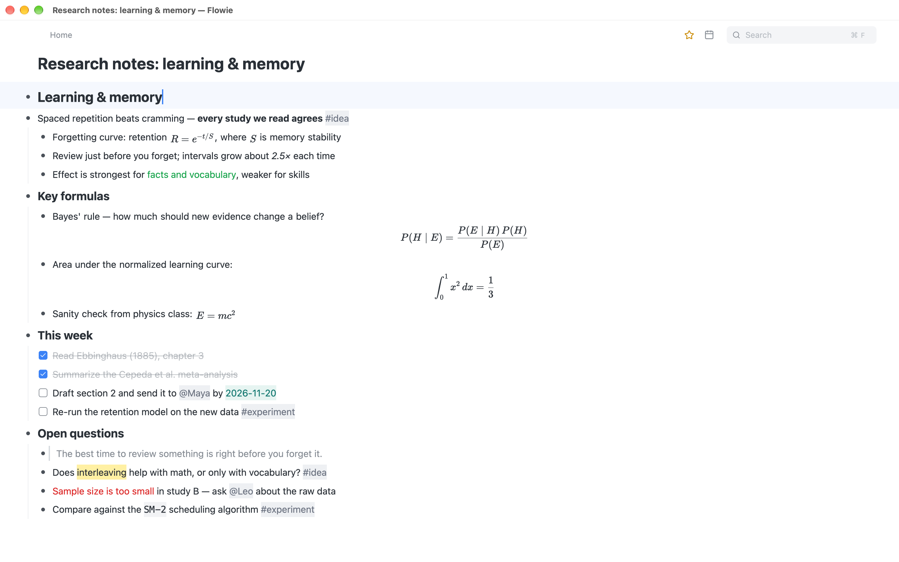

<p align="center"></p>

<h1 align="center">Flowie</h1>

<p align="center"><b>A fast, keyboard-first outliner for thinking in lists.</b><br>
Zoom into any bullet, link and mirror ideas, write math, and find anything instantly — all stored locally on your Mac.</p>

<p align="center">
  <a href="https://apps.apple.com/app/id6835913837"></a>
</p>

<p align="center">
  <a href="https://github.com/wesleyel/flowie/actions/workflows/ci.yml"></a>
  <a href="LICENSE"></a>
  
</p>

<p align="center"></p>

Flowie is an outliner in the spirit of Workflowy, built natively with [GPUI](https://gpui.rs)
(Zed's GPU UI framework) and [RaTeX](https://github.com/erweixin/RaTeX) for KaTeX-compatible math.

- **Every bullet is a page** — zoom in to focus, zoom out to see the whole picture, with smooth animations.
- **Write fast** — headings, to-dos, numbered lists, quotes, code, colors and highlights from the keyboard or the `/` menu.
- **Math** — inline `$…$` and display `$$…$$` LaTeX, rendered as you type.
- **Connect ideas** — `[[links]]` with backlinks, mirrors, `#tags`, `@mentions`, daily journal and calendar.
- **Find anything** — ⌘P to jump anywhere, search with filters, starred pages and saved searches.
- **Yours, offline** — one SQLite file on your Mac, no account, no tracking; import and export OPML, Markdown and text.
- **Works with AI assistants** — a built-in MCP server lets Claude and other agents read (and, if you allow it, edit) your outline.
- English and 简体中文; every shortcut can be rebound.

> **简体中文**：Flowie 是一款键盘优先的 Mac 原生大纲笔记。每个条目都是一个页面，支持双向链接、镜像、LaTeX 公式、日记与日历、强大的搜索，数据只保存在你的 Mac 上。可在 Mac App Store 购买（中国大陆以外地区），也可按下文自行编译。

## Open source and the App Store

Flowie is free software under the [GPL-3.0-or-later](LICENSE). You can build it yourself
from this repository at no cost. The [Mac App Store version](https://apps.apple.com/app/id6835913837)
is the same code, signed, sandboxed and updated automatically — buying it is the easy way
to get Flowie and the way to support its development.

## Build from source

Requirements: macOS 13+, the Xcode Command Line Tools and a recent stable Rust (`rustup`).

```bash
cargo build --release -p flowie-app
scripts/bundle-macos.sh target/release/flowie Flowie flowie.spokey.cn
open build/Flowie.app
```

No full Xcode is needed: GPUI's `runtime_shaders` feature compiles Metal shaders at launch.
The bundle is ad-hoc signed for your own Mac.

- Data: `~/Library/Application Support/Flowie/flowie.sqlite` (override with `FLOWIE_DB=/path/file.sqlite`).
  The Mac App Store build is sandboxed and keeps it in `~/Library/Containers/flowie.spokey.cn/Data/Library/Application Support/Flowie/`.
- `--stress 50000`: opens an in-memory outline of 50k bullets (not saved) and logs timings.
- Settings (⌘,) are saved in `settings.json` next to the database: theme, accent color, language (follow macOS or any bundled locale) and shortcut overrides. Click a shortcut to replace it, use `+` to add another keyboard or mouse side-button binding, and press Backspace while recording to remove that binding.

## Keys

| Key | Action |
|---|---|
| Enter | New bullet (splits at the caret) |
| Shift-Enter | Edit / leave the note |
| Tab / Shift-Tab | Indent / outdent |
| Backspace at start | Merge into the bullet above |
| ⌘Enter | Complete (or check a to-do) |
| ⌘↑ / ⌘↓ | Collapse / expand |
| ⌃1 … ⌃4 / ⌃0 | Show 1–4 levels / expand all |
| ⌘] / ⌘[ / ⌘⇧H | Zoom in / out / home (or click a bullet / breadcrumb) |
| Mouse back / forward, ⌘⌥← / ⌘⌥→ | Previous / next visited page (restores search and scroll position) |
| ⌘P | Go to: starred pages, saved searches, any bullet; a name that matches no bullet offers a new page on Home |
| ⌘⇧S | Star / unstar the page |
| ⌘⇧M | Move to… (an existing bullet or a new page on Home) |
| ⌘⌥M | Mirror a bullet here (live copy: edits show in both places) |
| ⌘⇧K or `[[` | Link to another bullet, or to a new page on Home (backlinks show at the bottom of its page) |
| ⌘⇧↑ / ⌘⇧↓ | Move bullet |
| ⌘⇧Backspace | Delete bullet (kept in Trash for 30 days) |
| Esc | Select whole bullets; Shift-↑/↓ or dragging across rows extends |
| `/` | Command menu: block types, colors, highlight, math, date, link, mirror, move |
| `#` / `@` | Tag / mention completion |
| ⌘⌥0–8 | Bullet, H1, H2, H3, text, to-do, numbered, quote, code block |
| ⌘B ⌘I ⌘E ⌘M ⌘K ⌘⇧Y | Bold, italic, code, math, link, highlight |
| ⌘F, ⌘G / ⌘⇧G | Search, next / previous match |
| ⌘⇧D | Today's journal page |
| ⌘⇧C | Calendar (click a day: its journal page; ⌥-click: bullets dated that day) |
| ⌘O | Show / hide completed |
| ⌘Z / ⌘⇧Z | Undo / redo |
| ⌘⇧I / ⌘⇧E | Import (OPML, Markdown, text — Workflowy exports work) / export Markdown |
| ⌘, | Settings: rebind any shortcut, theme (system / light / dark), accent color, language, about |

First launch opens a tutorial outline that covers every feature (Help → Flowie Tutorial adds a fresh copy); its text is `crates/flowie-app/tutorial/<locale>.md`.

File menu: export as OPML, Markdown or plain text (selected bullets, or the whole page), and the Trash.

Search terms: words, `"phrases"`, `-exclude`, `#tag`, `@person`, `is:done`, `is:open`, `is:todo`, `is:heading`, `is:quote`, `is:code`, `has:note`, `changed:7d` (`m`/`h`/`d`/`w`), `date:2026-11`, `date:today`, `before:2026-12-01`, `after:today`. Save a search from the header to run it later from ⌘P.

## Markup

`**bold**`, `*italic*`, `~~strike~~`, `` `code` ``, `==highlight==`, `{red}colored{/}` (red, orange, yellow, green, blue, purple, gray), `[label](url)`, `[label](flowie:ID)` (link to a bullet), bare URLs, `#tags`, `@mentions`, dates `2026-11-17` (click to find bullets with that date), inline math `$e^{i\pi}+1=0$` and display math `$$\int_0^1 x\,dx$$` (previewed under the line while editing). Markup characters are hidden except on the bullet being edited. `$5 and $6` stays plain text.

## Mac App Store build

```bash
scripts/package-appstore.sh            # universal, sandboxed, signed .pkg (needs the maintainer's certificates)
scripts/package-appstore.sh --local    # sandboxed, ad-hoc signed app for testing
```

Releases are managed with fastlane: [docs/appstore](docs/appstore/README.md).

## Agents (MCP)

Flowie includes an MCP server so AI agents can read and edit your outline. Allow it in **Settings → Agent** (Off / Read only / Read & write; default read only), then register it, e.g. for Claude Code:

```bash
claude mcp add flowie -- /path/to/Flowie.app/Contents/MacOS/Flowie mcp
```

`flowie mcp` speaks MCP over stdio and forwards to the running app through an owner-only Unix socket, starting Flowie in the background if needed. Edits go through the app, so they appear live, are saved normally, briefly highlight the changed bullets, and each tool call is one ⌘Z undo step; deletions go to the Trash.

Tools: `search`, `read` (Markdown with `[id:N]` per bullet), `starred`, `create` (Markdown list under a parent / after a bullet), `update`, `complete`, `move`, `delete`, `journal`, `open`.

## Layout

```
crates/flowie-core   tree, operations, undo, flattening, search, markup parser, SQLite store (tested)
crates/flowie-math   RaTeX layout + native GPUI painting of formulas (example: math_demo)
crates/flowie-app    the GPUI application
```

```bash
cargo test -p flowie-core
cargo run -p flowie-math --example math_demo
```

## Translations

UI text lives in `crates/flowie-app/locales/<code>.json` (nested JSON; a key is its dotted path, e.g. `menu.file.title`). `en.json` is the source and fallback. To add a language, drop in a new file with `meta.name` set to the language's own name; build.rs picks it up and it appears in Settings → Appearance → Language. Messages take `{name}` placeholders and plural objects (`{"one": …, "other": …}`, chosen by `count`). In code: `t!("menu.file.title")`, `t!("toast.moved", count = n, target = name)`.

```bash
cargo test -p flowie-app i18n -- --nocapture   # coverage report + key/placeholder checks
```

## Contributing

See [CONTRIBUTING.md](CONTRIBUTING.md). Bug reports and ideas: [issues](https://github.com/wesleyel/flowie/issues) or Help → Send Feedback… in the app.

## License and credits

Flowie is © 2026 Wesley Yang, licensed under the [GNU General Public License v3.0 or later](LICENSE).


Third-party crates are listed with their licenses in the app bundle (`Contents/Resources/ThirdPartyNotices.txt`, generated by cargo-about). Math fonts: KaTeX (SIL OFL). Icons: [Lucide](https://lucide.dev) (ISC license, `crates/flowie-app/assets/icons/LICENSE`).
