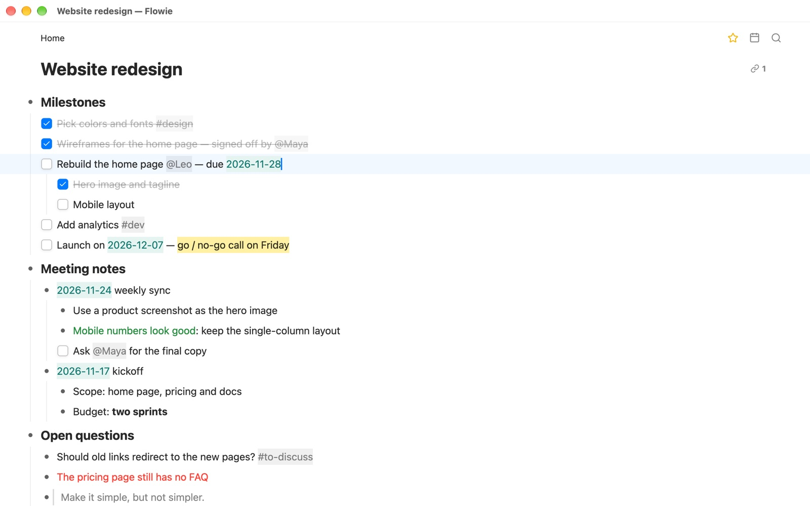
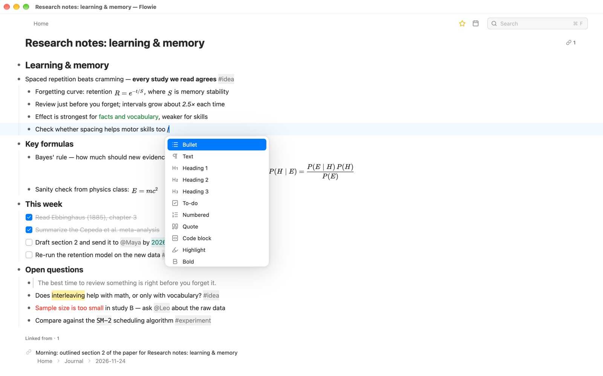
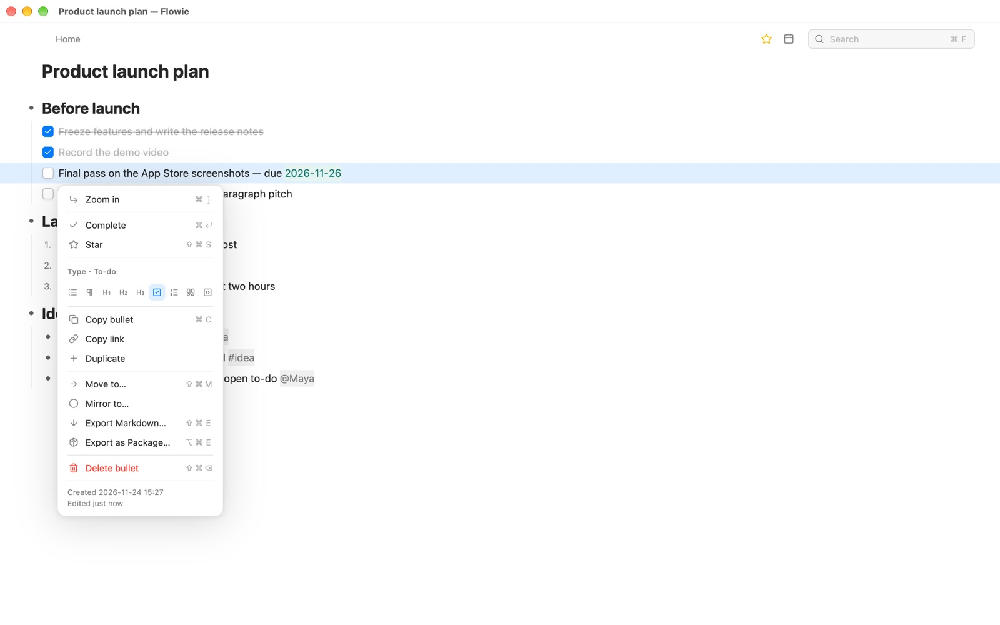
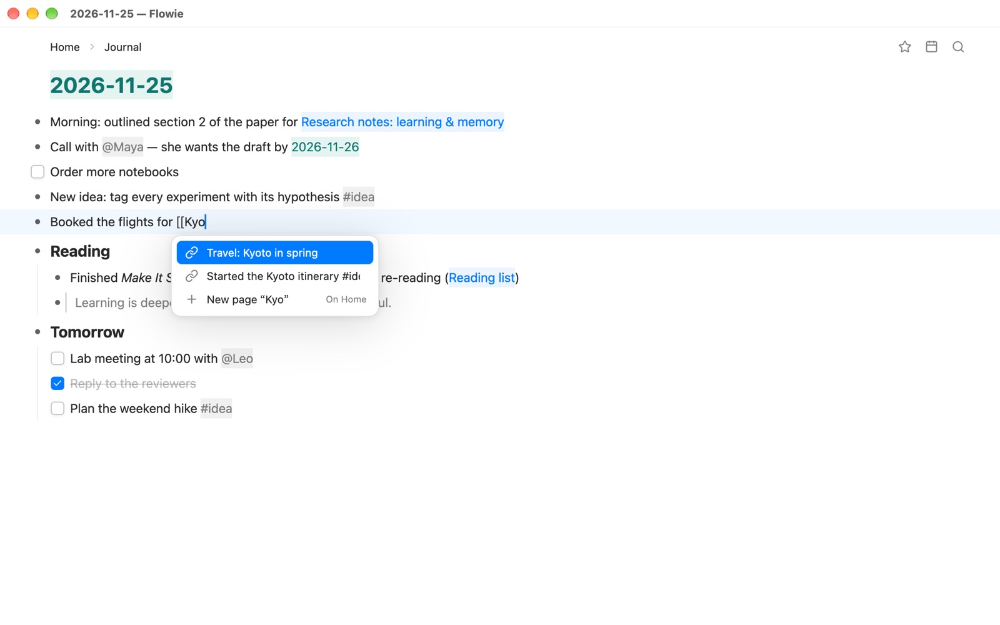
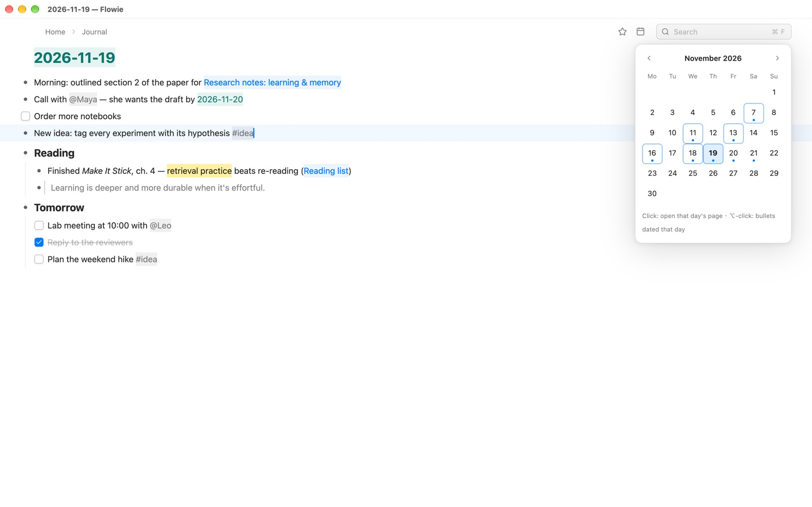
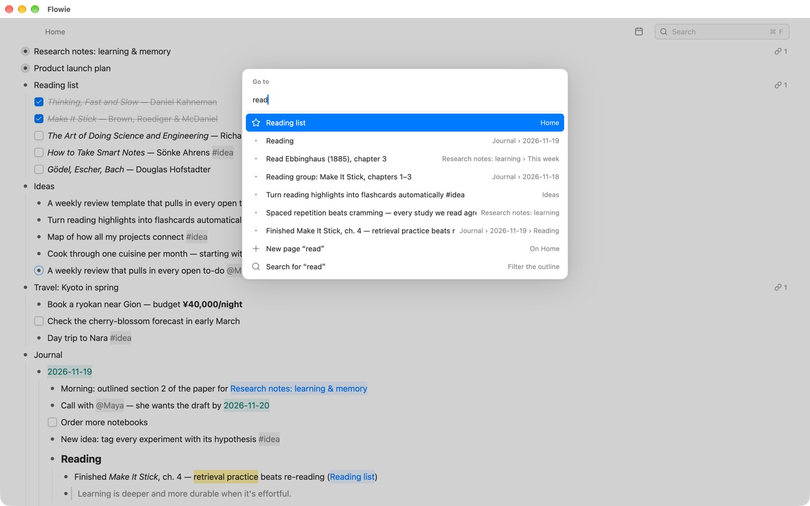
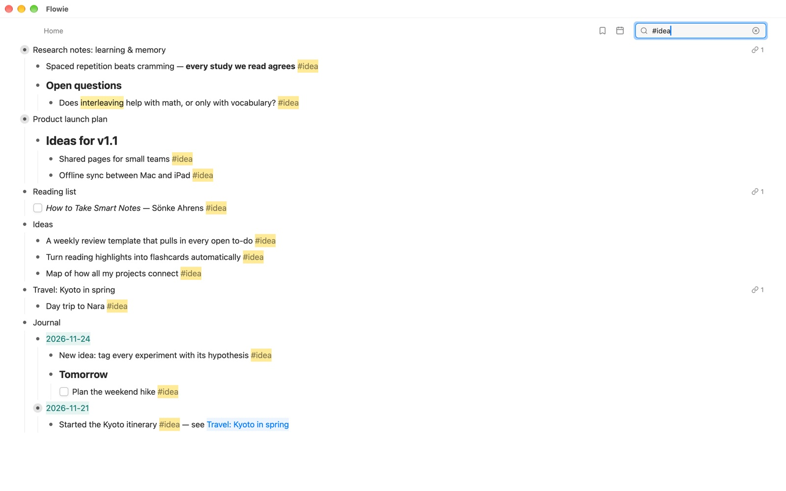
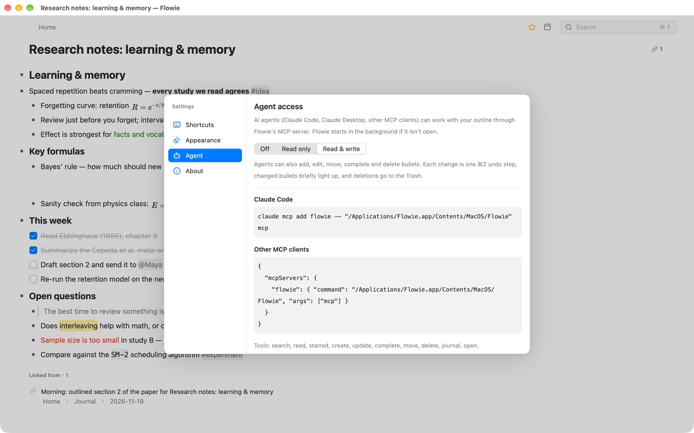

<h1 align="center">Flowie</h1>

<b>A fast, keyboard-first outliner for thinking in lists.</b> 
Zoom into any bullet, link and mirror ideas, write math, and find anything instantly — all stored locally on your Mac.

  

  
  
  

<b>English</b> · <a href="README.zh-CN.md">简体中文</a> · <a href="https://wesleyel.github.io/flowie/">Website</a>

## Features

**Write and organize**
- Every bullet is a page: zoom in to focus, zoom out to see the big picture, with smooth animations.
- Indent, collapse, move and drag bullets; select several and act on them together.
- Headings, to-dos, numbered lists, quotes, code blocks and plain text, from the keyboard or the `/` menu.
- Bold, italic, strikethrough, highlight, seven colors and links — markup shows only on the bullet you're editing.
- Notes under any bullet, and undo for everything.

  
  

**Math**
- Inline `$…$` and display `$$…$$` LaTeX, rendered natively as you type, with a live preview while editing.

**Connect ideas**
- Link to any bullet with `[[` and see backlinks on its page.
- Mirrors: one bullet in several places — edit it anywhere, it changes everywhere.
- `#tags` and `@mentions` with completion; clickable dates.
- A journal page for every day and a calendar to get around.

  
  

**Find anything**
- ⌘P jumps to any bullet, starred page or saved search — or creates a new page.
- Search with filters: phrases, tags, people, to-dos, completed, headings, notes, dates and "changed in the last N days".

  
  

**Your data, on your Mac**
- One local SQLite database. No account, no cloud, no tracking.
- Import OPML, Markdown and text (Workflowy exports work); export Markdown, OPML or text.
- Deleted bullets stay in the Trash for 30 days.

**Made for the keyboard**
- Every action has a shortcut, and every shortcut can be changed — including mouse side buttons.
- A built-in tutorial that covers every feature.
- Light and dark themes, accent colors, English and 简体中文.

**Works with AI assistants**
- A built-in [MCP](https://modelcontextprotocol.io) server lets Claude and other assistants read your outline — and edit it, if you allow it. Every change is live and undoable.

## Get Flowie

- **[Mac App Store](https://apps.apple.com/app/id6835913837)** — signed, sandboxed and updated automatically. Buying it is the easiest way to get Flowie and the way to support its development.
- **Open-source version** — `Flowie-<version>-macos.zip` on the [Releases](https://github.com/wesleyel/flowie/releases) page; versions ending in `-rc.N` are release candidates. It isn't notarized: right-click Flowie.app and choose **Open** the first time (on macOS 15 or later, **System Settings → Privacy & Security → Open Anyway**). It doesn't update itself.
- **Homebrew** — the same open-source version: `brew install --cask wesleyel/tap/flowie`, and `brew upgrade` keeps it current, release candidates included.
- **Build it yourself** — Flowie is free software; see [docs/building.md](docs/building.md).

Requires macOS 13 Ventura or later, on Apple silicon or Intel.

## Learn more

- [Using Flowie](docs/usage.md) — shortcuts, markup and search syntax
- [AI assistants (MCP)](docs/mcp.md)
- [Translating Flowie](docs/translations.md)
- [Changelog](CHANGELOG.md) · [Contributing](CONTRIBUTING.md) · [Security](SECURITY.md) · [Issues](https://github.com/wesleyel/flowie/issues) · [Privacy policy](https://wesleyel.github.io/flowie/privacy.html)

## License

© 2026 Wesley Yang. Flowie is licensed under the [GNU General Public License v3.0 or later](LICENSE).
It builds on [GPUI](https://gpui.rs), [RaTeX](https://github.com/erweixin/RaTeX), KaTeX fonts and
[Lucide](https://lucide.dev) icons; the app bundle lists every third-party license.
