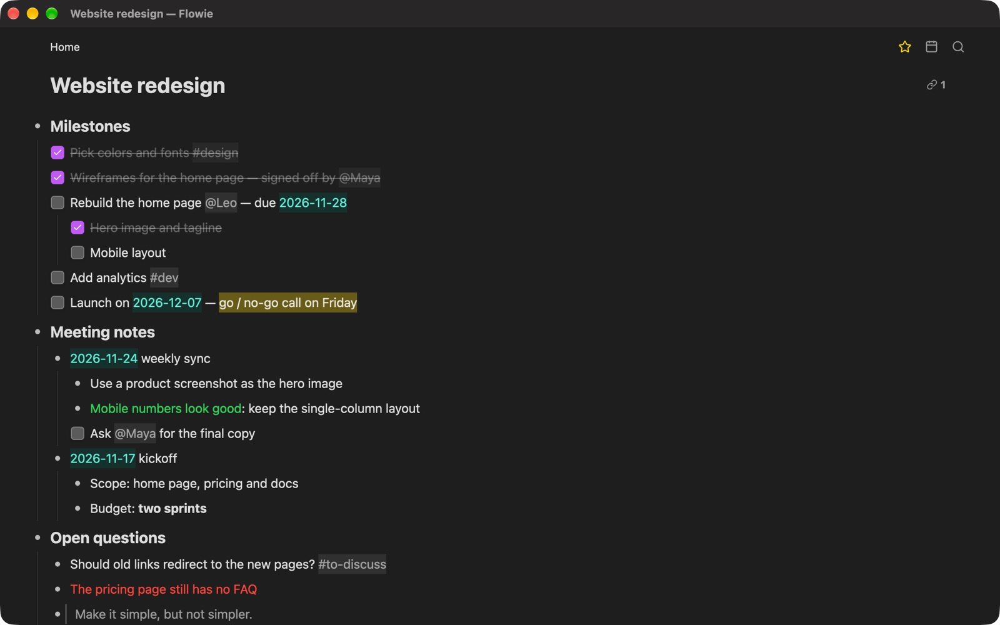

<p align="center"></p>

<h1 align="center">Flowie</h1>

<p align="center"><b>A fast, keyboard-first outliner for thinking in lists.</b><br>
Zoom into any bullet, link and mirror ideas, write math, and search your outline. Your notes are stored on your device.</p>

<p align="center">
  <a href="https://apps.apple.com/app/id6835913837"></a>
</p>

<p align="center">
  <a href="https://github.com/wesleyel/flowie/actions/workflows/ci.yml"></a>
  <a href="LICENSE"></a>
  
  
</p>

<p align="center"><b>English</b> · <a href="README.zh-CN.md">简体中文</a> · <a href="https://wesleyel.github.io/flowie/">Website</a> · <a href="website/images">Screenshots</a></p>

<p align="center"></p>

## Fast with big outlines

Measured on an Apple M4 with Bike's *Moby-Dick* outline imported five times, 13,505 bullets
([benchmark](crates/flowie-core/benches/large_outline.rs): `scripts/fetch-bench-data.sh`, then
`cargo bench -p flowie-core --bench large_outline`):

| Benchmark | Result |
|---|---:|
| Import all 13,505 bullets | 42 ms |
| Lay out the whole outline, everything expanded | 1.3 ms |
| Save it to the database (in the background) | 99 ms |
| The outline in memory | 9.6 MB |
| Undo for the entire import | 0.4 MB |
| Read a 6.4 MB Markdown file | 6 ms |

Flowie is native Rust drawn on the GPU with [GPUI](https://gpui.rs). It draws only the rows on
screen, and works out every other row's height from its text, so the scrollbar is right before
you scroll.

## Features

**Write and organize**
- Every bullet is a page: zoom in to focus, zoom out to see the big picture, with smooth animations.
- Indent, collapse, move and drag bullets; select several and act on them together.
- Headings, to-dos, numbered lists, quotes, code blocks and plain text, from the keyboard or the `/` menu.
- Bold, italic, strikethrough, highlight, seven colors and links — markup shows only on the bullet you're editing.
- Notes under any bullet, and undo for everything.
- Paste or drop images into the outline and add captions.

**Math**
- Inline `$…$` and display `$$…$$` LaTeX, rendered natively as you type, with a live preview while editing.

**Connect ideas**
- Link to any bullet with `[[`. Hover over an internal link to preview its target, or open the target to see backlinks.
- Mirrors: one bullet in several places — edit it anywhere, it changes everywhere.
- `#tags` and `@mentions` with completion; clickable dates.
- A journal page for every day and a calendar to get around.

**Find anything**
- ⌘P jumps to any bullet, starred page or saved search — or creates a new page.
- Search with filters: phrases, tags, people, to-dos, completed, headings, notes, dates and "changed in the last N days".

**Keep and share your notes**
- Flowie stores the outline in a local SQLite database. No account, no cloud, no tracking.
- Import OPML, Markdown and text (Workflowy exports work); export Markdown, OPML or text.
- Flowie's OPML exports keep internal links and mirrors. To take images with you, use a `.flowie` package or keep the `images` folder with your Markdown export.
- Share a branch as a `.flowie` file. The recipient can preview it, choose where to import it, and merge later updates while keeping their own edits. Use `is:new` to find unread imports.
- Deleted bullets stay in the Trash for 30 days.

**Made for the keyboard**
- Every action has a shortcut, and every shortcut can be changed — including mouse side buttons.
- A built-in tutorial: a quick start, three examples to adapt and a manual covering every feature.
- Light and dark themes, accent colors, English and 简体中文.
- Read release notes in the app under **Help → What's New**.

**Works with AI assistants**
- A built-in [MCP](https://modelcontextprotocol.io) server lets Claude and other assistants read your outline — and edit it, if you allow it. Every change is live and undoable.

<p align="center"></p>

## Get Flowie

### macOS

Requires macOS 13 or later on Apple silicon or Intel.

- **Mac App Store** — a signed, sandboxed build with automatic updates. Buying it supports development. [Get it on the Mac App Store](https://apps.apple.com/app/id6835913837).
- **Homebrew** — install with `brew install --cask wesleyel/tap/flowie` and update with `brew upgrade --cask wesleyel/tap/flowie`.
- **GitHub** — download `Flowie-<version>-macos.zip`, unzip it and move `Flowie.app` to Applications. [Download from GitHub Releases](https://github.com/wesleyel/flowie/releases/latest).

The Homebrew and GitHub builds are not notarized, so macOS won't open them at first. After moving Flowie to Applications (or installing it with Homebrew), clear the quarantine flag in Terminal, then open it; do this again after each update:

```sh
xattr -dr com.apple.quarantine /Applications/Flowie.app
```

### Windows (preview)

Requires Windows 10 or 11 (x64). Download `Flowie-<version>-windows-x64.zip`, unzip it and run `Flowie.exe`. There is no native Windows ARM64 package. [Download from GitHub Releases](https://github.com/wesleyel/flowie/releases/latest).

### Linux (preview)

For x86_64 with glibc 2.35 or later (Ubuntu 22.04 and newer). Download `Flowie-<version>-linux-x86_64.AppImage`, make it executable and run it, or extract `Flowie-<version>-linux-x86_64.tar.gz` into `~/.local` (`tar -xzf Flowie-<version>-linux-x86_64.tar.gz -C ~/.local --strip-components=1`) and run `flowie`. [Download from GitHub Releases](https://github.com/wesleyel/flowie/releases/latest). The Linux build is a preview; [what it needs](docs/building.md#linux).

Homebrew follows the newest version, including [release candidates](https://github.com/wesleyel/flowie/releases). The latest-release link is for stable versions. See the [installation guide](https://wesleyel.github.io/flowie/download.html) for checksums and how to preserve an outline when upgrading from a candidate to 1.0.

### Build from source

You can build Flowie on macOS, Windows or Linux. [Build guide](docs/building.md).

## Learn more

- [Using Flowie](docs/usage.md) — shortcuts, markup and search syntax
- [AI assistants (MCP)](docs/mcp.md)
- [Translating Flowie](docs/translations.md)
- [Changelog](CHANGELOG.md) · [Contributing](CONTRIBUTING.md) · [Security](SECURITY.md) · [Issues](https://github.com/wesleyel/flowie/issues) · [Privacy policy](https://wesleyel.github.io/flowie/privacy.html)

## Credits

Flowie builds on [GPUI](https://gpui.rs), [RaTeX](https://github.com/erweixin/RaTeX), KaTeX fonts and [Lucide](https://lucide.dev) icons.

Thanks to the [LINUX DO](https://linux.do) community for feedback and support.

## License

© 2026 Wesley Yang. Flowie is licensed under the [GNU General Public License v3.0 or later](LICENSE); the app bundle lists every third-party license.
