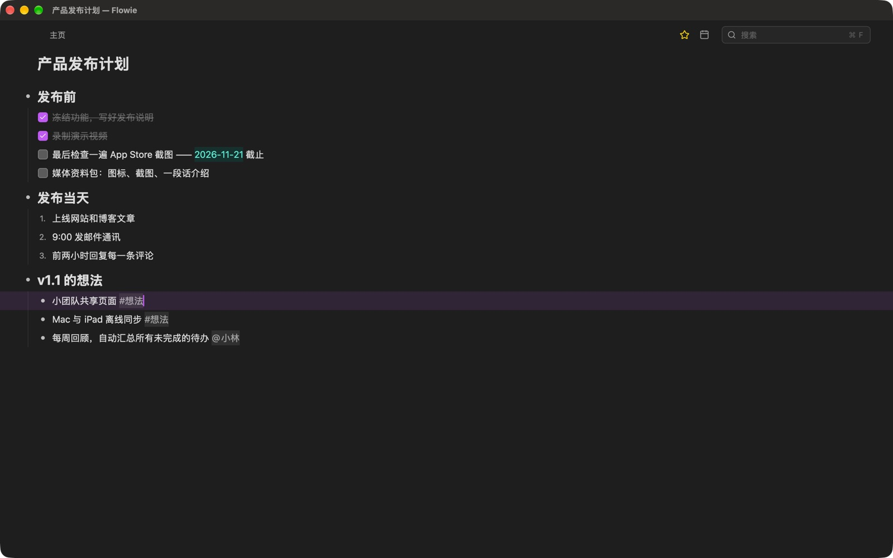

<p align="center"></p>

<h1 align="center">Flowie 大纲笔记</h1>

<p align="center"><b>键盘优先，用列表思考。</b><br>
进入任意条目，链接和镜像笔记，写公式，搜索大纲。笔记保存在你自己的设备上。</p>

<p align="center">
  <a href="https://apps.apple.com/app/id6835913837"></a>
</p>

<p align="center">
  <a href="https://github.com/wesleyel/flowie/actions/workflows/ci.yml"></a>
  <a href="LICENSE"></a>
  
  
</p>

<p align="center"><a href="README.md">English</a> · <b>简体中文</b> · <a href="https://wesleyel.github.io/flowie/">官网</a> · <a href="website/images">截图</a></p>

<p align="center"></p>

## 大纲再大也快

在 Apple M4 上，把 Bike 的《白鲸》大纲导入五遍，共 13,505 个条目
（[benchmark](crates/flowie-core/benches/large_outline.rs)：先运行 `scripts/fetch-bench-data.sh`，再运行
`cargo bench -p flowie-core --bench large_outline`）：

| 测试项目 | 结果 |
|---|---:|
| 导入全部 13,505 个条目 | 42 ms |
| 全部展开后排出整个大纲 | 1.3 ms |
| 存入数据库（后台进行） | 99 ms |
| 大纲占用的内存 | 9.6 MB |
| 整次导入的撤销记录 | 0.4 MB |
| 读入 6.4 MB 的 Markdown 文件 | 6 ms |

Flowie 是原生 Rust 应用，用 [GPUI](https://gpui.rs) 在 GPU 上绘制。它只绘制屏幕上的行，其余每一行的高度都根据文字算出来，
所以滚动之前滚动条就是准的。

## 功能

**书写与整理**
- 每个条目都是一个页面：进入它专注细节，退出来纵览全局，过渡动画流畅。
- 缩进、折叠、移动、拖动条目；多选后一起操作。
- 标题、待办、编号列表、引用、代码块、正文，用快捷键或 `/` 菜单切换。
- 加粗、斜体、删除线、高亮、七种颜色和链接——只有正在编辑的条目才显示标记符号。
- 任意条目都能写备注，所有操作都能撤销。
- 把图片粘贴或拖进大纲，还能给图片加一行说明。

**数学公式**
- 行内 `$…$` 与独立 `$$…$$` LaTeX 公式，原生实时渲染，编辑时在行下方预览。

**连接想法**
- 输入 `[[` 链接到任意条目。鼠标停在链接上就能预览，打开目标页面就能看到反向链接。
- 镜像：同一个条目出现在多个地方，在哪里编辑都会同步。
- `#标签` 和 `@提及` 自动补全；日期可以点击。
- 每天一页日记，配合日历快速跳转。

**查找一切**
- ⌘P 跳转到任意条目、收藏页面或保存的搜索，也能直接新建页面。
- 带条件的搜索：短语、标签、人名、待办、已完成、标题、备注、日期，以及「最近 N 天修改过」。

**保存和分享笔记**
- 大纲存在本地 SQLite 数据库。无需账号，没有云服务，没有追踪。
- 通过你自己运行的 Flowie 服务器（`flowie-server`，见 [docs/sync.md](docs/sync.md)）在几台电脑之间同步：每个条目单独同步，离线时的修改也不会丢。
- 导入 OPML、Markdown 和纯文本（支持 Workflowy 导出文件）；导出 Markdown、OPML 或纯文本。
- Flowie 导出的 OPML 会保留内部链接和镜像。要一起带走图片，可以用 `.flowie` 分享包，或者带上 Markdown 导出时附带的 `images` 文件夹。
- 把条目、子项和图片打包成 `.flowie` 文件发给别人。对方可以先预览，再选位置导入。收到新版分享包时，可以合并变更，保留自己的修改。用 `is:new` 查找未读条目。
- 删除的条目在废纸篓保留 30 天。

**为键盘而生**
- 每个操作都有快捷键，每个快捷键都能修改——鼠标侧键也可以绑定。
- 内置教程：快速入门、三个可以直接改用的示例，以及覆盖全部功能的手册。
- 浅色与深色主题、强调色，支持简体中文与英文。
- 打开「帮助 → 新功能」，就能看到每个版本改了什么。

**与 AI 助手协作**
- 内置 [MCP](https://modelcontextprotocol.io) 服务器，Claude 等 AI 助手可以读取你的大纲；你允许后还能编辑。每次修改都实时可见，并且可以撤销。

<p align="center"></p>

## 获取 Flowie

### macOS 13+

- [Mac App Store](https://apps.apple.com/app/id6835913837)
- [GitHub Releases](https://github.com/wesleyel/flowie/releases/latest)
- **Homebrew**: `brew install --cask wesleyel/tap/flowie`

Homebrew 和 GitHub 提供的版本未经公证，macOS 一开始会拒绝打开。把 Flowie 移到「应用程序」（或用 Homebrew 安装）之后，在终端运行下面的命令去掉隔离标记，再打开它；更新后重复此操作

```sh
xattr -dr com.apple.quarantine /Applications/Flowie.app
```

### Windows 10/11（x64）预览版

- [GitHub Releases](https://github.com/wesleyel/flowie/releases/latest)

### Linux x86_64 预览版

- [GitHub Releases](https://github.com/wesleyel/flowie/releases/latest)

### 从源码构建

- [编译指南](docs/building.md)

## 了解更多

- [使用说明](docs/usage.md)：快捷键、标记语法与搜索语法（英文）
- [AI 助手（MCP）](docs/mcp.md)
- [参与翻译](docs/translations.md)
- [更新日志](CHANGELOG.zh-CN.md) · [参与贡献](CONTRIBUTING.md) · [安全问题](SECURITY.md) · [问题反馈](https://github.com/wesleyel/flowie/issues) · [隐私政策](https://wesleyel.github.io/flowie/privacy.html)

## 致谢

Flowie 基于 [GPUI](https://gpui.rs)、[RaTeX](https://github.com/erweixin/RaTeX)、KaTeX 字体和 [Lucide](https://lucide.dev) 图标构建。

感谢 [LINUX DO](https://linux.do) 社区的反馈与支持。

## 许可证

© 2026 Wesley Yang。Flowie 以 [GNU 通用公共许可证 v3.0 或更高版本](LICENSE) 授权；应用包内附有全部第三方许可证。
