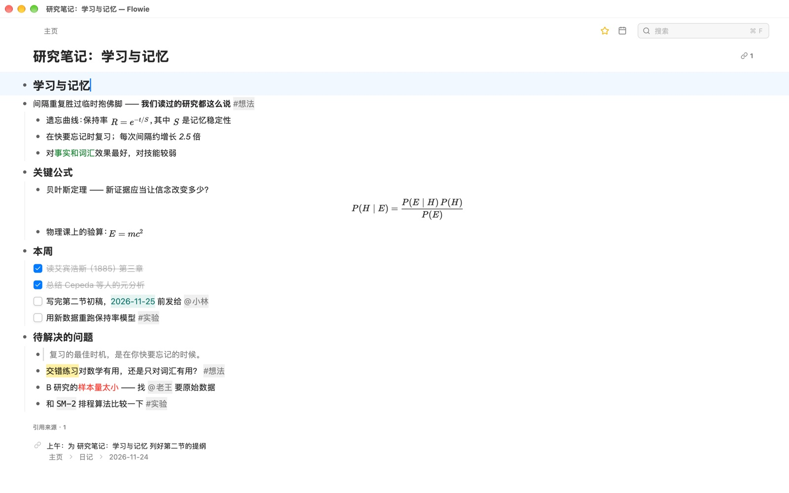
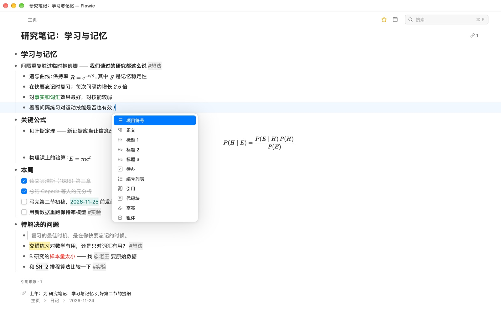
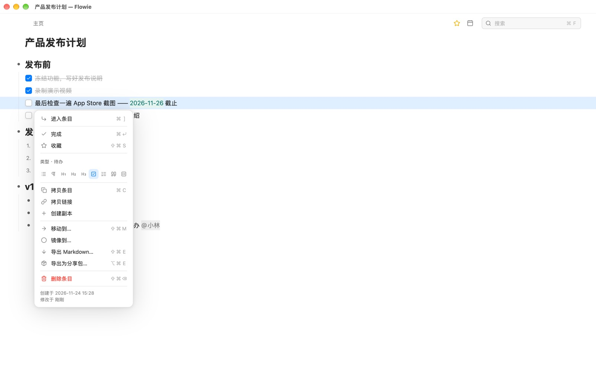
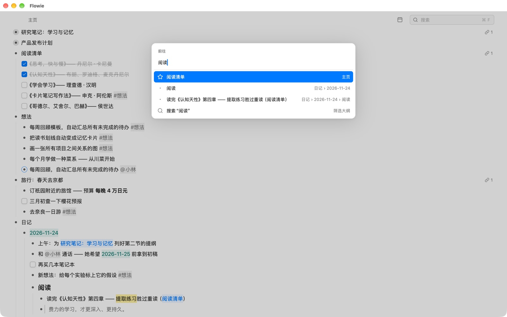
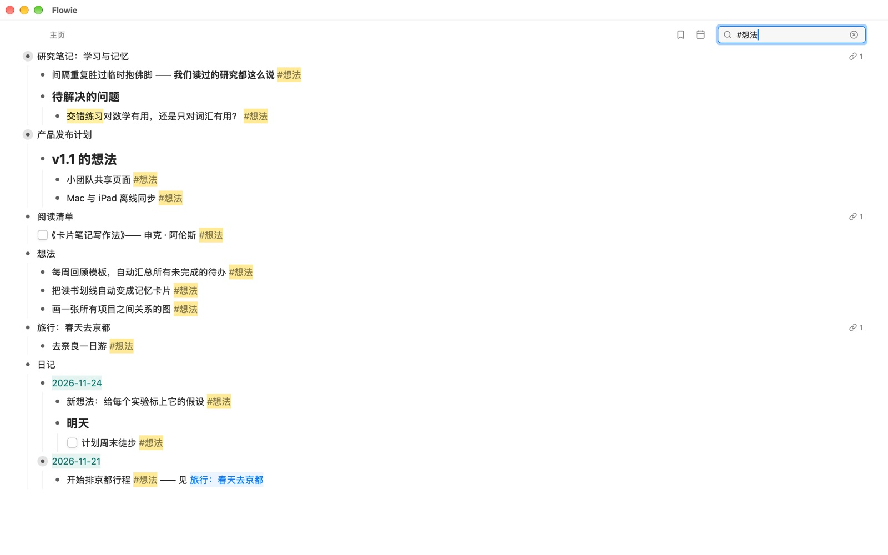
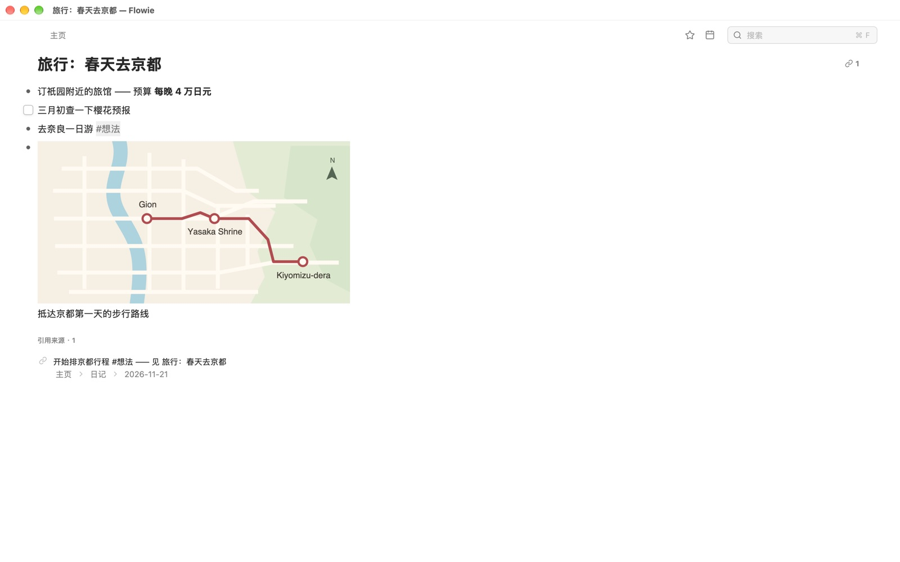
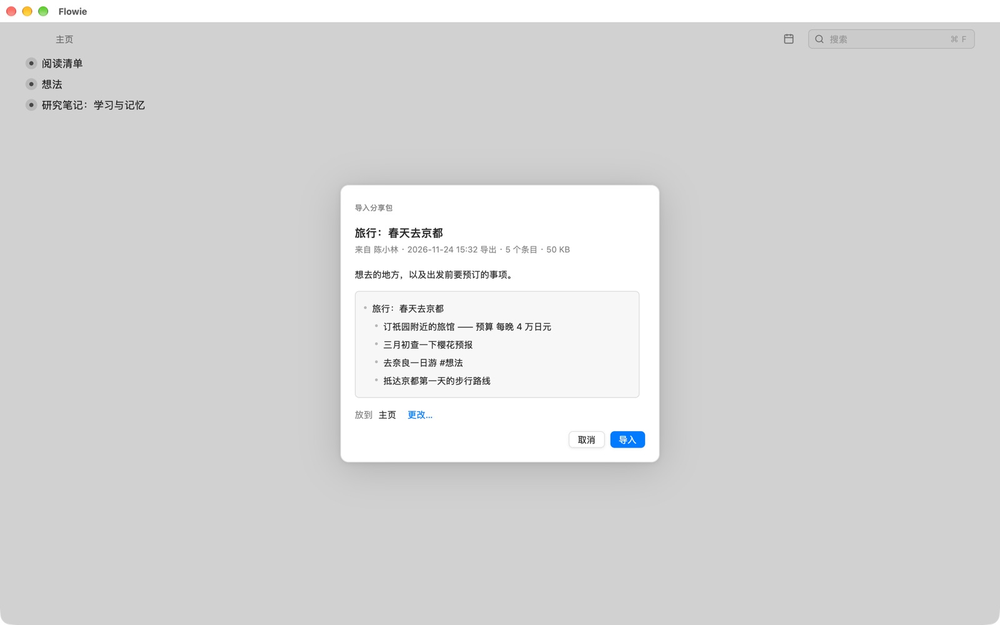
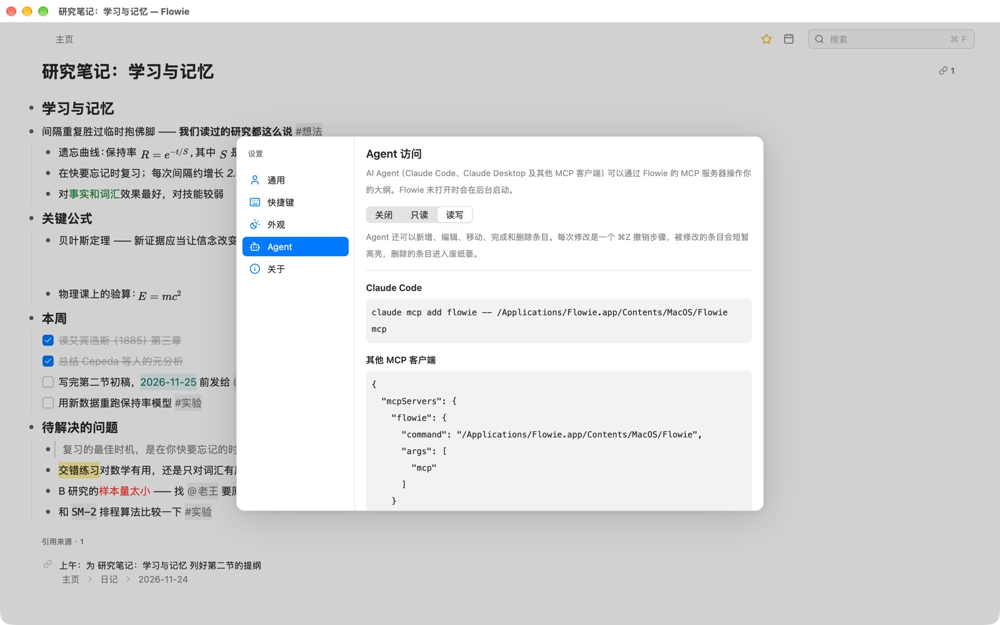

<h1 align="center">Flowie 大纲笔记</h1>

<b>键盘优先，用列表思考。</b> 
进入任意条目，链接和镜像笔记，写公式，搜索大纲。笔记保存在你自己的设备上。

  

  
  
  
  

<a href="README.md">English</a> · <b>简体中文</b> · <a href="https://wesleyel.github.io/flowie/">官网</a>

## 功能

**书写与整理**
- 每个条目都是一个页面：进入它专注细节，退出来纵览全局，过渡动画流畅。
- 缩进、折叠、移动、拖动条目；多选后一起操作。
- 标题、待办、编号列表、引用、代码块、正文，用快捷键或 `/` 菜单切换。
- 加粗、斜体、删除线、高亮、七种颜色和链接——只有正在编辑的条目才显示标记符号。
- 任意条目都能写备注，所有操作都能撤销。
- 把图片粘贴或拖进大纲，还能给图片加一行说明。

  
  

**数学公式**
- 行内 `$…$` 与独立 `$$…$$` LaTeX 公式，原生实时渲染，编辑时在行下方预览。

**连接想法**
- 输入 `[[` 链接到任意条目。鼠标停在链接上就能预览，打开目标页面就能看到反向链接。
- 镜像：同一个条目出现在多个地方，在哪里编辑都会同步。
- `#标签` 和 `@提及` 自动补全；日期可以点击。
- 每天一页日记，配合日历快速跳转。

  
  

**查找一切**
- ⌘P 跳转到任意条目、收藏页面或保存的搜索，也能直接新建页面。
- 带条件的搜索：短语、标签、人名、待办、已完成、标题、备注、日期，以及「最近 N 天修改过」。

  
  

**保存和分享笔记**
- 大纲存在本地 SQLite 数据库。无需账号，没有云端，没有追踪。
- 导入 OPML、Markdown 和纯文本（支持 Workflowy 导出文件）；导出 Markdown、OPML 或纯文本。
- Flowie 导出的 OPML 会保留内部链接和镜像。要一起带走图片，可以用 `.flowie` 分享包，或者带上 Markdown 导出时附带的 `images` 文件夹。
- 把条目、子项和图片打包成 `.flowie` 文件发给别人。对方可以先预览，再选位置导入。收到新版分享包时，可以合并变更，保留自己的修改。用 `is:new` 查找未读条目。
- 删除的条目在废纸篓保留 30 天。

  
  

**为键盘而生**
- 每个操作都有快捷键，每个快捷键都能修改——鼠标侧键也可以绑定。
- 内置教程，覆盖全部功能。
- 浅色与深色主题、强调色，支持简体中文与英文。
- 打开「帮助 → 新功能」，就能看到每个版本改了什么。

**与 AI 助手协作**
- 内置 [MCP](https://modelcontextprotocol.io) 服务器，Claude 等 AI 助手可以读取你的大纲；你允许后还能编辑。每次修改都实时可见，并且可以撤销。

## 获取 Flowie

### macOS

需要 macOS 13 或更高版本，支持 Apple 芯片和 Intel。

- **Mac App Store** 版本经过签名，在沙盒中运行，可自动更新。购买可以支持开发。中国大陆地区暂未上架。[前往 Mac App Store](https://apps.apple.com/app/id6835913837)。
- **Homebrew** 用 `brew install --cask wesleyel/tap/flowie` 安装，用 `brew upgrade --cask wesleyel/tap/flowie` 更新。
- **GitHub** 下载 `Flowie-<版本号>-macos.zip`，解压后把 `Flowie.app` 移到「应用程序」。[前往 GitHub Releases 下载](https://github.com/wesleyel/flowie/releases/latest)。

Homebrew 和 GitHub 提供的版本未经公证。如果 macOS 15 或更高版本阻止打开，先尝试打开一次，再到「系统设置 → 隐私与安全性」点「仍要打开」。在更早的 macOS 上，右键点按应用，选择「打开」。

### Windows

需要 Windows 10 或 11（64 位）。下载 `Flowie-<版本号>-windows-x64.zip`，解压后运行 `Flowie.exe`。[前往 GitHub Releases 下载](https://github.com/wesleyel/flowie/releases/latest)。

GitHub Releases 和 Homebrew 都提供候选版（`-rc.N`）。

### 从源码构建

macOS、Windows 和 Linux 都可以从源码构建。[编译指南](docs/building.md)。

## 了解更多

- [使用说明](docs/usage.md)：快捷键、标记语法与搜索语法（英文）
- [AI 助手（MCP）](docs/mcp.md)
- [参与翻译](docs/translations.md)
- [更新日志](CHANGELOG.zh-CN.md) · [参与贡献](CONTRIBUTING.md) · [安全问题](SECURITY.md) · [问题反馈](https://github.com/wesleyel/flowie/issues) · [隐私政策](https://wesleyel.github.io/flowie/privacy.html)

## 许可证

© 2026 Wesley Yang。Flowie 以 [GNU 通用公共许可证 v3.0 或更高版本](LICENSE) 授权。
它基于 [GPUI](https://gpui.rs)、[RaTeX](https://github.com/erweixin/RaTeX)、KaTeX 字体和 [Lucide](https://lucide.dev) 图标构建；应用包内附有全部第三方许可证。
