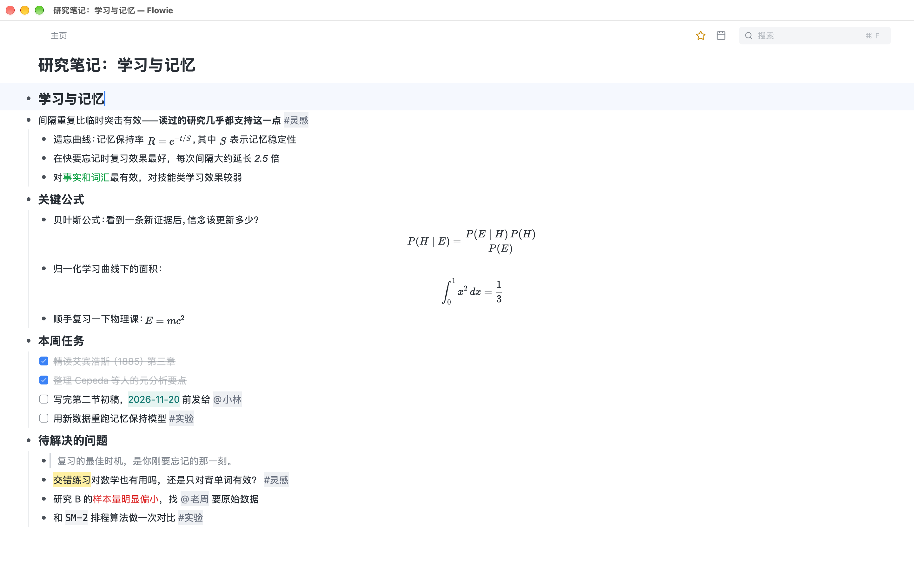
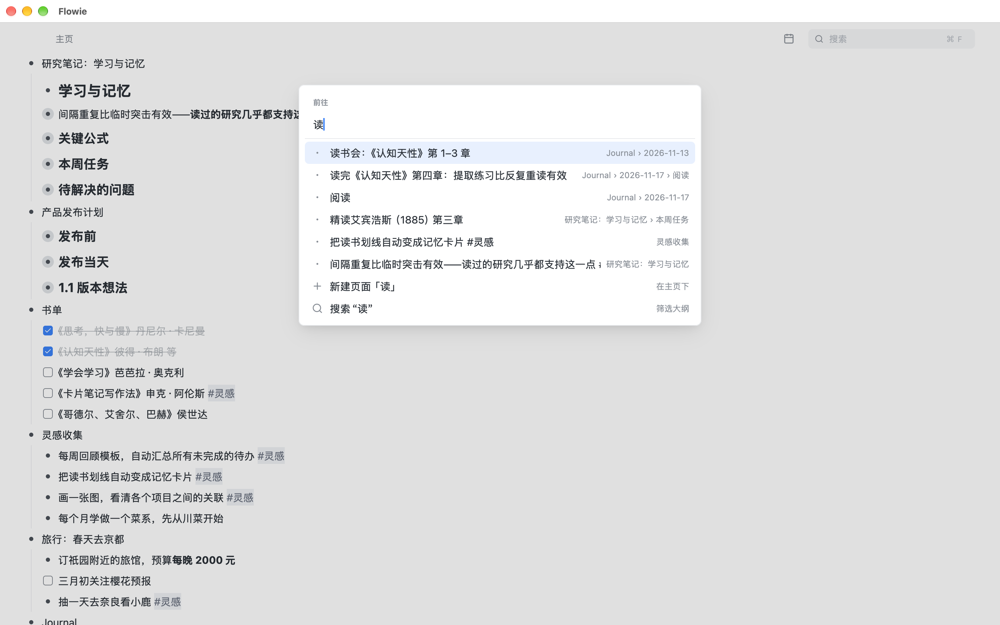
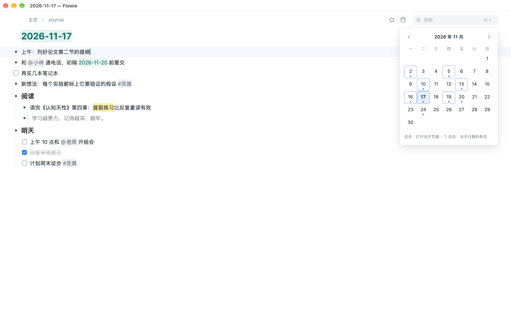

<h1 align="center">Flowie 大纲笔记</h1>

<b>键盘优先，用列表思考。</b> 
进入任意条目、链接与镜像想法、书写公式、瞬间找到一切——所有数据只保存在你的 Mac 上。

  

  
  
  

<a href="README.md">English</a> · <b>简体中文</b> · <a href="https://wesleyel.github.io/flowie/">官网</a>

## 功能

**书写与整理**
- 每个条目都是一个页面：进入它专注细节，退出来纵览全局，过渡动画流畅。
- 缩进、折叠、移动、拖动条目；多选后一起操作。
- 标题、待办、编号列表、引用、代码块、正文，用快捷键或 `/` 菜单切换。
- 加粗、斜体、删除线、高亮、七种颜色和链接——只有正在编辑的条目才显示标记符号。
- 任意条目都能写备注，所有操作都能撤销。

**数学公式**
- 行内 `$…$` 与独立 `$$…$$` LaTeX 公式，原生实时渲染，编辑时在行下方预览。

**连接想法**
- 输入 `[[` 链接到任意条目，在目标页面底部看到反向链接。
- 镜像：同一个条目出现在多个地方，在哪里编辑都会同步。
- `#标签` 和 `@提及` 自动补全；日期可以点击。
- 每天一页日记，配合日历快速跳转。

**查找一切**
- ⌘P 跳转到任意条目、收藏页面或保存的搜索，也能直接新建页面。
- 带条件的搜索：短语、标签、人名、待办、已完成、标题、备注、日期，以及「最近 N 天修改过」。

**数据只在你的 Mac 上**
- 一个本地 SQLite 数据库。无需账号，没有云端，没有追踪。
- 导入 OPML、Markdown 和纯文本（支持 Workflowy 导出文件）；导出 Markdown、OPML 或纯文本。
- 删除的条目在废纸篓保留 30 天。

**为键盘而生**
- 每个操作都有快捷键，每个快捷键都能修改——鼠标侧键也可以绑定。
- 内置教程，覆盖全部功能。
- 浅色与深色主题、强调色，支持简体中文与英文。

**与 AI 助手协作**
- 内置 [MCP](https://modelcontextprotocol.io) 服务器，Claude 等 AI 助手可以读取你的大纲；你允许后还能编辑。每次修改都实时可见，并且可以撤销。

  
  

## 获取 Flowie

- **[Mac App Store](https://apps.apple.com/app/id6835913837)**：经过签名和沙盒保护，自动更新。购买是获取 Flowie 最省事的方式，也是对开发的支持。（暂未在中国大陆地区上架。）
- **自行编译**：Flowie 是自由软件，步骤见 [docs/building.md](docs/building.md)。

需要 macOS 13 Ventura 或更高版本，支持 Apple 芯片和 Intel 处理器。

## 了解更多

- [使用说明](docs/usage.md)：快捷键、标记语法与搜索语法（英文）
- [AI 助手（MCP）](docs/mcp.md)
- [参与翻译](docs/translations.md)
- [参与贡献](CONTRIBUTING.md) · [安全问题](SECURITY.md) · [问题反馈](https://github.com/wesleyel/flowie/issues) · [隐私政策](https://wesleyel.github.io/flowie/privacy.html)

## 许可证

© 2026 Wesley Yang。Flowie 以 [GNU 通用公共许可证 v3.0 或更高版本](LICENSE) 授权。
它基于 [GPUI](https://gpui.rs)、[RaTeX](https://github.com/erweixin/RaTeX)、KaTeX 字体和 [Lucide](https://lucide.dev) 图标构建；应用包内附有全部第三方许可证。
